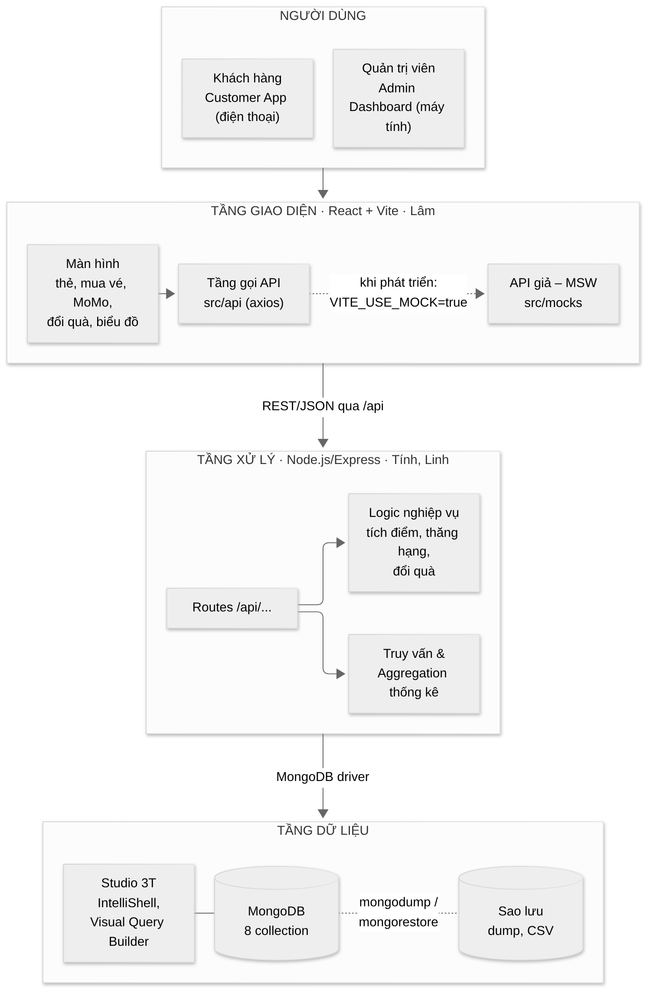
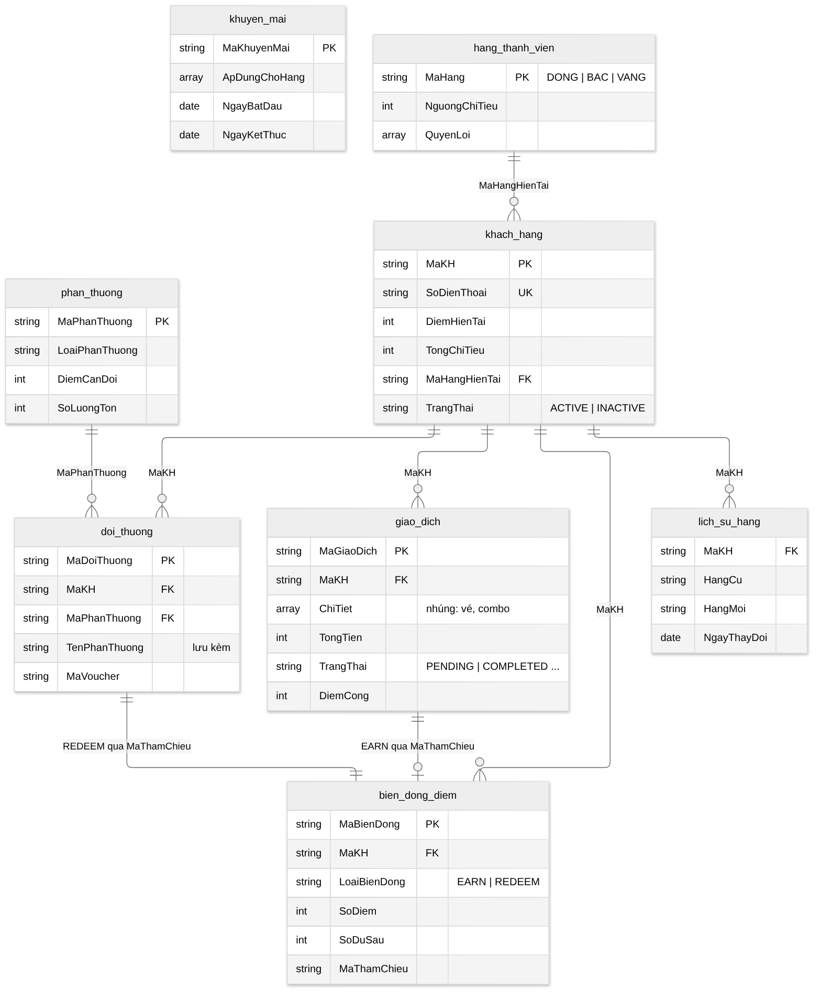
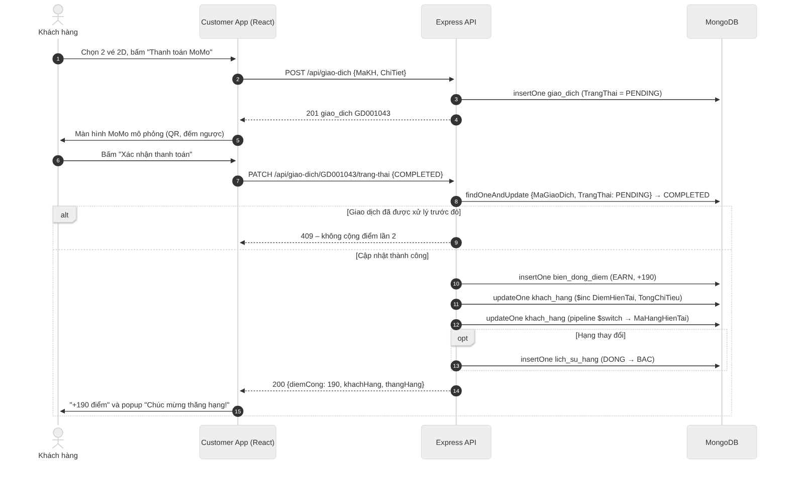
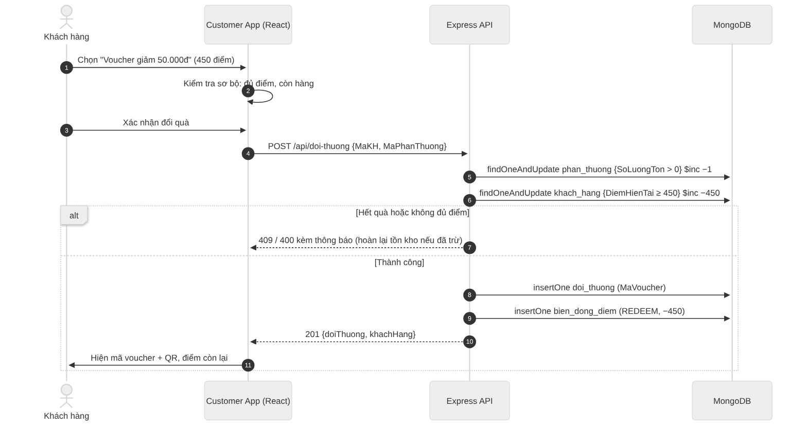
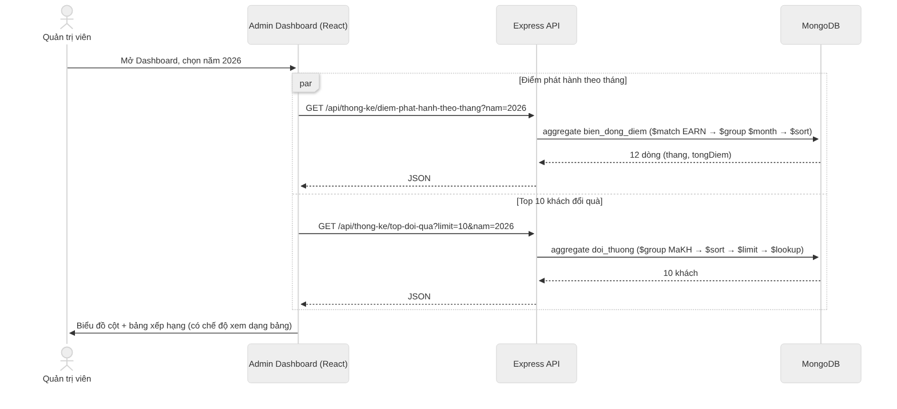
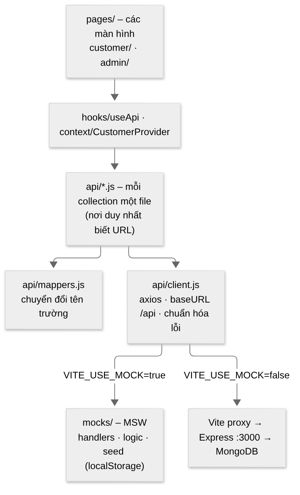
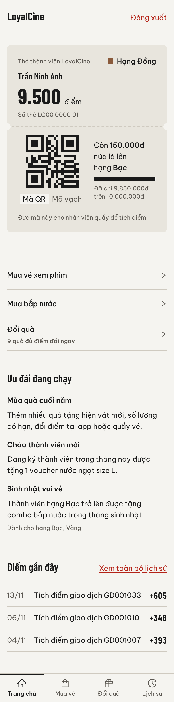
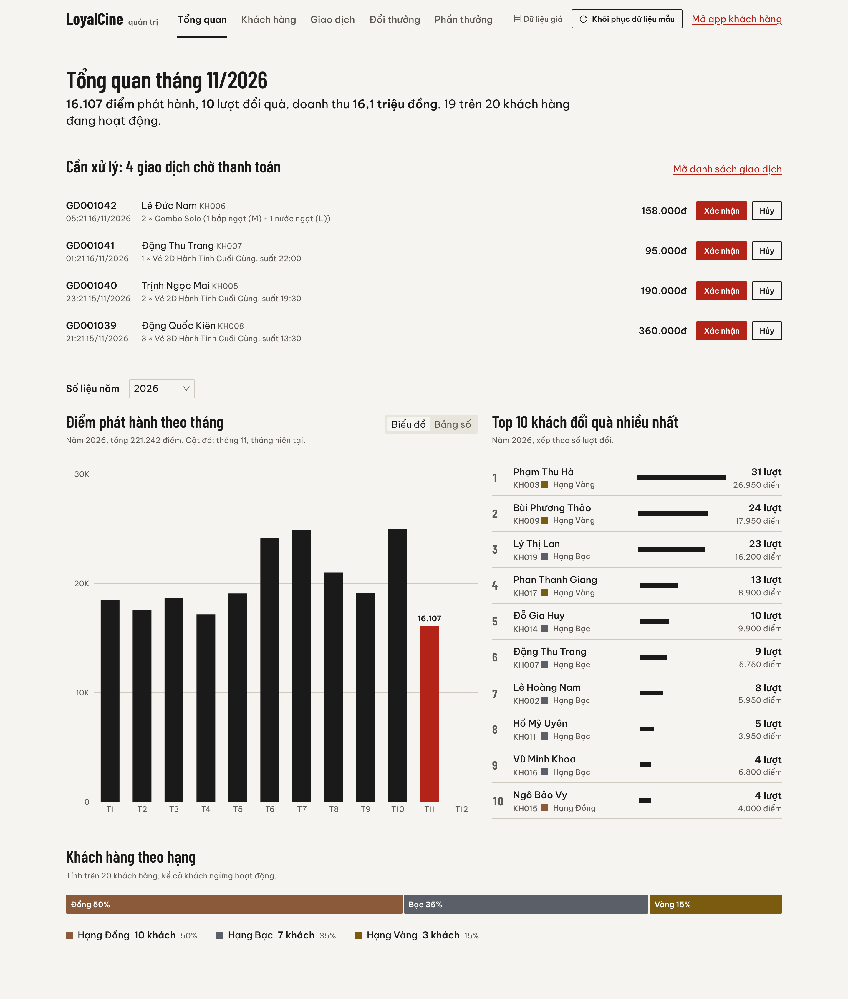

# ĐẶC TẢ KIẾN TRÚC PHẦN MỀM – ỨNG DỤNG KHÁCH HÀNG THÂN THIẾT RẠP CHIẾU PHIM

> **Bản nháp (phần Khánh Lâm phụ trách).** Các mục ghi **[Bổ sung: …]** do Tính hoặc Linh điền khi backend hoàn thiện. Số liệu và ảnh chụp hiện lấy từ bản chạy dữ liệu giả (mock). Khi chốt báo cáo cuối kỳ, cần thay bằng ảnh chụp dữ liệu thật.

## 1. Mục tiêu và phạm vi

Hệ thống mô phỏng chương trình khách hàng thân thiết của một chuỗi rạp chiếu phim:

- Khách hàng tích điểm khi mua vé hoặc combo bắp nước. Thanh toán được mô phỏng qua ví MoMo.
- Khách được **tự động thăng hạng** Đồng → Bạc → Vàng theo tổng chi tiêu (mốc 10 triệu và 30 triệu đồng).
- Khách dùng điểm đổi voucher vé, voucher bắp nước hoặc quà hiện vật.
- Quản trị viên xem thống kê điểm phát hành theo tháng, top khách đổi quà và tra cứu khách hàng.

Trọng tâm của đồ án là **thiết kế và khai thác cơ sở dữ liệu NoSQL (MongoDB)**: mô hình document, truy vấn CRUD, aggregation pipeline, sao lưu và khôi phục. Ứng dụng web là lớp minh họa cho luồng dữ liệu đi từ giao diện xuống MongoDB.

Ngoài phạm vi:

- Xác thực thật: đăng nhập chỉ mô phỏng bằng số điện thoại.
- Thanh toán thật: màn hình MoMo chỉ là mô phỏng.
- Quản lý lịch chiếu và phòng chiếu.

## 2. Kiến trúc tổng thể



*Hình 1. Kiến trúc tổng thể 3 tầng*

Hệ thống theo kiến trúc **3 tầng (3-tier)**, các tầng giao tiếp qua REST/JSON:

| Tầng | Thành phần | Trách nhiệm | Người phụ trách |
|---|---|---|---|
| Giao diện | React SPA (Vite) gồm 2 phân hệ: *Customer App* (bố cục điện thoại) và *Admin Dashboard* (bố cục máy tính) | Hiển thị và tương tác. Gọi API qua một tầng duy nhất `src/api`. Không chứa logic tính điểm. | Khánh Lâm |
| Xử lý | Node.js/Express, các route có tiền tố `/api` | CRUD, logic tích điểm, thăng hạng, đổi quà, aggregation thống kê | Trung Tính (khung, CRUD), Yến Linh (nghiệp vụ, thống kê) |
| Dữ liệu | MongoDB (8 collection) và Studio 3T | Lưu trữ, index, truy vấn; sao lưu bằng `mongodump`/`mongorestore`, xuất CSV | Trung Tính, Yến Linh |

**Vì sao tách tầng như vậy:**

- MongoDB lưu document dạng BSON. Express trả trực tiếp JSON gần như nguyên dạng document, nên frontend nhận đúng cấu trúc dữ liệu mà không phải ánh xạ bảng sang đối tượng như CSDL quan hệ.
- Hai bên thống nhất trước **hợp đồng API** (`01-hop-dong-api.md`), nhờ đó frontend dùng **API giả (MSW)** để phát triển song song với backend. Khi backend xong, chỉ cần đặt `VITE_USE_MOCK=false`.

## 3. Công nghệ sử dụng

| Thành phần | Công nghệ | Ghi chú |
|---|---|---|
| CSDL | MongoDB | Document store, aggregation pipeline |
| Công cụ CSDL | Studio 3T | IntelliShell, Visual Query Builder, Aggregation Editor, Import/Export |
| Backend | Node.js + Express, MongoDB Node.js Driver (hoặc Mongoose) | **[Bổ sung: phiên bản, thư viện – Tính]** |
| Frontend | React 19, Vite 8, React Router 7 | SPA, tải từng trang khi cần |
| Thư viện giao diện | Ant Design 6 (tiếng Việt), Recharts 3 | Bảng, form, biểu đồ |
| Mã thành viên | QR Code (Ant Design), Barcode CODE128 (react-barcode) | Mã hóa `MaThe` |
| API giả | MSW 3 (Mock Service Worker) | Dữ liệu giả lưu ở localStorage |
| Kiểm thử | Vitest (logic), Playwright (chạy trọn kịch bản demo) | 23 unit test, 18 bước E2E |

## 4. Kiến trúc dữ liệu

### 4.1. Các collection

| Collection | Vai trò | Liên kết |
|---|---|---|
| `khach_hang` | Hồ sơ thành viên, điểm hiện có, tổng chi tiêu, hạng hiện tại, trạng thái | `MaHangHienTai` → `hang_thanh_vien` |
| `hang_thanh_vien` | Định nghĩa hạng Đồng/Bạc/Vàng, ngưỡng chi tiêu, quyền lợi | – |
| `giao_dich` | Đơn mua vé/combo, có **mảng `ChiTiet` nhúng** và trạng thái thanh toán | `MaKH` → `khach_hang` |
| `bien_dong_diem` | Sổ cái điểm, chỉ ghi thêm: EARN (+) / REDEEM (−) | `MaKH`, `MaThamChieu` → `giao_dich` / `doi_thuong` |
| `phan_thuong` | Danh mục quà: voucher vé, voucher bắp nước, quà hiện vật; điểm cần đổi; tồn kho | – |
| `doi_thuong` | Lượt đổi quà, mã voucher, hạn dùng | `MaKH`, `MaPhanThuong` |
| `khuyen_mai` | Chương trình ưu đãi theo thời gian và hạng | `ApDungChoHang` (mảng mã hạng) |
| `lich_su_hang` | Lịch sử thay đổi hạng của khách | `MaKH` |



*Hình 2. Quan hệ giữa các collection (mũi tên thể hiện tham chiếu bằng mã nghiệp vụ, không phải khóa ngoại cứng)*

### 4.2. Các quyết định thiết kế theo hướng NoSQL

1. **Nhúng (embed) `ChiTiet` vào `giao_dich`.** Các dòng sản phẩm luôn được đọc và ghi cùng đơn hàng, số lượng ít và không cần truy vấn riêng. Nhúng giúp một lần đọc lấy đủ đơn hàng, không cần join.
2. **Tham chiếu (reference) bằng `MaKH`** từ `giao_dich`, `bien_dong_diem`, `doi_thuong`, `lich_su_hang`. Các collection này tăng không giới hạn theo thời gian. Nếu nhúng vào `khach_hang`, document sẽ phình to, có nguy cơ vượt giới hạn 16 MB.
3. **Lưu kèm (denormalize) `TenPhanThuong`, `LoaiPhanThuong` trong `doi_thuong`.** Màn hình "Quà của tôi" hiển thị được ngay mà không cần `$lookup`. Tên quà là dữ liệu tại thời điểm đổi nên được phép không đổi theo danh mục.
4. **`bien_dong_diem` là sổ cái chỉ ghi thêm (append-only).** Không sửa hay xóa dòng cũ. `SoDuSau` giúp đối soát: `DiemHienTai` của khách phải bằng tổng `SoDiem` của khách đó.
5. **Lưu sẵn `DiemHienTai` và `TongChiTieu` trong `khach_hang`** (giá trị tổng hợp được cache). Trang chủ và thẻ thành viên đọc rất thường xuyên, nên tránh phải aggregate lại toàn bộ lịch sử mỗi lần mở app. Hai giá trị này chỉ được cập nhật bằng `$inc` khi có giao dịch hoặc đổi quà.
6. **Hạng xét theo `TongChiTieu`, không theo `DiemHienTai`.** Đổi quà không làm khách tụt hạng.

### 4.3. Index đề xuất

| Collection | Index | Phục vụ |
|---|---|---|
| `khach_hang` | `{MaKH: 1}` unique, `{SoDienThoai: 1}` unique | Tra cứu, đăng nhập bằng SĐT, chống trùng |
| `giao_dich` | `{MaGiaoDich: 1}` unique, `{MaKH: 1, NgayTao: -1}` | Lịch sử giao dịch của khách |
| `bien_dong_diem` | `{MaKH: 1, NgayTao: -1}`, `{LoaiBienDong: 1, NgayTao: 1}` | Lịch sử điểm; thống kê EARN theo tháng |
| `doi_thuong` | `{MaKH: 1, NgayDoi: -1}` | Quà của tôi; top đổi quà |
| `phan_thuong` | `{MaPhanThuong: 1}` unique | Đổi quà |

**[Bổ sung: JSON Schema validation cho từng collection lấy từ báo cáo giữa kỳ – Tính]**

## 5. Kiến trúc API

- Chuẩn response: `{ success, data, message }`. Mã lỗi `400`/`403`/`404`/`409`/`500` có thông báo tiếng Việt. Chi tiết xem `01-hop-dong-api.md`.
- Nhóm endpoint:
  - **Khách hàng** (CRUD, lịch sử)
  - **Hạng/Khuyến mãi** (đọc)
  - **Giao dịch** (tạo, cập nhật trạng thái)
  - **Phần thưởng/Đổi thưởng**
  - **Thống kê** (aggregation)
- **[Bổ sung: cấu trúc thư mục backend (routes / controllers / services / models), cách kết nối MongoDB và cấu hình biến môi trường – Tính]**
- **[Bổ sung: danh sách pipeline aggregation đưa từ Studio 3T vào code, kèm ảnh chụp Aggregation Editor – Linh]**

## 6. Các luồng nghiệp vụ chính

### 6.1. Thanh toán → tích điểm → thăng hạng



*Hình 3. Luồng thanh toán MoMo (mô phỏng), tích điểm và thăng hạng*

Các điểm đảm bảo tính nhất quán:

- Giao dịch được tạo ở trạng thái `PENDING`. Điểm **chỉ được cộng khi chuyển `PENDING → COMPLETED`**, và việc chuyển trạng thái dùng `findOneAndUpdate` có điều kiện `TrangThai: "PENDING"`. Thao tác này nguyên tử, nên nếu người dùng bấm "Xác nhận" 2 lần thì request thứ hai nhận `409` và không cộng điểm thêm.
- Hạng được tính lại bằng pipeline `$switch` trên `TongChiTieu`. Khi hạng đổi thì ghi `lich_su_hang`.
- Nếu MongoDB chạy dạng replica set, có thể gộp các bước 8–13 trong một **transaction**.

### 6.2. Đổi quà



*Hình 4. Luồng đổi quà bằng điểm*

- Trừ tồn kho và trừ điểm bằng **update có điều kiện** (`SoLuongTon > 0`, `DiemHienTai ≥ DiemCanDoi`). Cách này không bao giờ làm tồn kho hoặc điểm bị âm, kể cả khi nhiều người đổi cùng lúc.
- Nếu bước trừ điểm thất bại sau khi đã trừ tồn kho, phải hoàn lại tồn kho, hoặc dùng transaction.
- Ghi `doi_thuong` (sinh `MaVoucher`) và ghi `bien_dong_diem` loại REDEEM (số âm).

### 6.3. Thống kê cho Admin Dashboard



*Hình 5. Hai pipeline aggregation phục vụ Dashboard*

- *Điểm phát hành theo tháng:* `$match` (EARN, theo năm) → `$group` theo `$month` (múi giờ Asia/Ho_Chi_Minh) → `$sort`. Trả về đủ 12 tháng.
- *Top 10 khách đổi quà:* `$group` theo `MaKH` → `$sort` → `$limit 10` → `$lookup khach_hang` để lấy họ tên.

## 7. Kiến trúc Frontend



*Hình 6. Các lớp trong frontend và cơ chế chuyển đổi giữa API giả và API thật*

| Màn hình | Chức năng | API sử dụng |
|---|---|---|
| Đăng nhập | Đăng nhập mô phỏng bằng SĐT, chọn nhanh tài khoản demo | `GET /khach-hang?soDienThoai=` |
| Trang chủ | Tấm vé thành viên (QR/mã vạch), điểm, hạng, thanh tiến trình "Còn … nữa là lên hạng …", các việc hay làm, ưu đãi, điểm gần đây | `GET /khach-hang/:maKH`, `/hang-thanh-vien`, `/khuyen-mai`, `/bien-dong-diem` |
| Mua vé / Bắp nước | Bảng giờ chiếu: chọn ngày, phim, định dạng, suất, số vé hoặc combo; xem tổng tiền và điểm dự kiến | `POST /giao-dich` |
| Thanh toán MoMo (mô phỏng) | Hóa đơn: QR, đếm ngược 15 phút, xác nhận hoặc hủy; màn kết quả và hộp thoại lên hạng | `GET /giao-dich/:maGD`, `PATCH /giao-dich/:maGD/trang-thai` |
| Đổi quà | Bảng giá bằng điểm: nhóm "Đủ điểm đổi ngay" và "Chưa đổi được" (ghi số điểm còn thiếu hoặc hết quà); voucher dạng vé có mã và QR | `GET /phan-thuong`, `POST /doi-thuong` |
| Lịch sử | Sổ điểm chia theo tháng, có số dư sau mỗi lần; tab Giao dịch, Quà của tôi, Hạng | các API `/khach-hang/:maKH/...` |
| Admin › Tổng quan | Câu tóm tắt tháng, giao dịch chờ thanh toán (xác nhận hoặc hủy ngay), biểu đồ điểm theo tháng (có chế độ xem dạng bảng), top 10 đổi quà, phân bố khách theo hạng | `/thong-ke/*` |
| Admin › Khách hàng | Tìm kiếm, lọc, thêm, sửa, xóa; xem chi tiết và lịch sử | CRUD `/khach-hang` |
| Admin › Giao dịch | Lọc theo trạng thái; chuyển `PENDING → COMPLETED` để minh họa cơ chế tự cộng điểm | `GET /giao-dich`, `PATCH .../trang-thai` |
| Admin › Đổi thưởng, Phần thưởng | Danh sách lượt đổi; tồn kho quà | `GET /doi-thuong`, `GET /phan-thuong` |

Nguyên tắc thiết kế frontend:

- **Một nơi duy nhất biết URL** (`src/api`). **Một nơi duy nhất chuyển đổi tên trường** (`src/api/mappers.js`). Khi backend đổi tên trường, các màn hình không phải sửa.
- **API giả bằng MSW:** chặn request `/api/...` ngay trong trình duyệt, trả dữ liệu đúng hợp đồng và mô phỏng logic. Dữ liệu giả lưu ở localStorage, có nút "Khôi phục dữ liệu mẫu" tương tự `mongorestore`.
- **Giao diện theo `DESIGN.md` (hướng "Vé giấy"):** nền giấy vé in nhiệt, chữ mực đen, đỏ con dấu chỉ dùng cho nút chính và link; font Barlow Condensed cho tiêu đề và con số, Be Vietnam Pro cho nội dung (cả hai lưu sẵn trong project, hiển thị đủ dấu tiếng Việt). Màu, cỡ chữ, khoảng cách lấy từ một chỗ (`src/design/tokens.js`, `src/index.css`).
- **Biểu đồ:**
  - Cột màu mực. Chỉ cột tháng hiện tại (hoặc tháng cao nhất khi xem năm cũ) màu đỏ dấu và có ghi số; các tháng khác xem qua gợi ý khi rê chuột hoặc chế độ **xem dạng bảng**.
  - Phân bố khách theo hạng dùng 3 màu hạng (Đồng, Bạc, Vàng), luôn kèm chữ và số khách.



*Hình 7. Customer App – tấm vé thành viên, QR và thanh tiến trình lên hạng (dữ liệu giả)*



*Hình 8. Admin Dashboard – giao dịch chờ xử lý, điểm phát hành theo tháng và top 10 khách đổi quà (dữ liệu giả)*

## 8. Triển khai và vận hành

Khi demo, cả hệ thống chạy trên máy cục bộ, gồm 3 tiến trình:

| Tiến trình | Lệnh | Cổng |
|---|---|---|
| MongoDB | `mongod` (hoặc service MongoDB) | 27017 |
| Backend | `node server.js` / `npm start` **[Bổ sung – Tính]** | 3000 |
| Frontend | `cd frontend && npm run dev` | 5173 |

Sao lưu, khôi phục và xuất dữ liệu (Linh phụ trách):
```bash
mongodump --db <ten_db> --out ./backup/2026-11-30          # sao lưu toàn bộ dữ liệu + index
mongorestore --db <ten_db> --drop ./backup/2026-11-30/<ten_db>   # khôi phục về trạng thái chuẩn
mongoexport --db <ten_db> --collection khach_hang --type=csv --fields MaKH,HoTen,SoDienThoai,DiemHienTai,TongChiTieu,MaHangHienTai --out khach_hang.csv
```
**[Bổ sung: tên database thật, ảnh chụp thao tác Export trong Studio 3T – Linh]**

## 9. Giới hạn và hướng phát triển

- Đăng nhập mới chỉ là mô phỏng. Hướng phát triển: OTP qua SMS, JWT, phân quyền Admin.
- Thanh toán MoMo mới chỉ là mô phỏng. Hướng phát triển: tích hợp sandbox của cổng thanh toán, nhận IPN để chuyển trạng thái `COMPLETED`.
- Khuyến mãi hiện chỉ để hiển thị. Hướng phát triển: áp dụng hệ số điểm theo khuyến mãi hoặc theo hạng ngay trong pipeline tính điểm.
- Chưa có hạn dùng điểm. Hướng phát triển: dùng TTL index hoặc job định kỳ để ghi `bien_dong_diem` loại `EXPIRE`.
